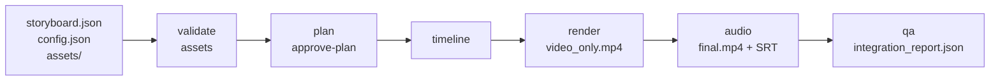

# AI Video Editor Core

> Công cụ dòng lệnh (CLI) viết bằng Python, điều phối FFmpeg để **tự động dựng video** từ storyboard JSON: ảnh tĩnh có chuyển động Zoom/Pan, chuỗi ảnh animation, video clip có sẵn, giọng đọc, nhạc nền và phụ đề.


---

## Mục lục

- [Tính năng](#tính-năng)
- [Yêu cầu hệ thống](#yêu-cầu-hệ-thống)
- [Cài đặt](#cài-đặt)
- [Bắt đầu nhanh](#bắt-đầu-nhanh)
- [Luồng xử lý](#luồng-xử-lý)
- [Cấu trúc một project](#cấu-trúc-một-project)
- [Viết storyboard](#viết-storyboard)
- [Danh sách lệnh](#danh-sách-lệnh)
- [Cache, checkpoint và resume](#cache-checkpoint-và-resume)
- [Cấu trúc repository](#cấu-trúc-repository)
- [Chạy test](#chạy-test)
- [Hạn chế hiện tại](#hạn-chế-hiện-tại)
- [Tài liệu](#tài-liệu)
- [Giấy phép](#giấy-phép)

---

## Tính năng

**Ba loại cảnh (scene)**

| Loại | Mô tả |
|---|---|
| `image` | Ảnh tĩnh với chuyển động camera Zoom/Pan (OpenCV Lanczos4, có supersampling) |
| `image_sequence` | Chuỗi frame đánh số liên tục (`frame_0001.png` …), phát nguyên trạng không nội suy |
| `video_clip` | Video MP4/MOV/MKV có sẵn, tự chuẩn hóa FPS và độ phân giải, giữ tiếng gốc |

**Âm thanh**

- Giọng đọc theo từng cảnh, đặt chính xác theo **từng mẫu âm thanh (sample)**, không bao giờ bị cắt hay kéo giãn.
- Tiếng gốc của video clip được đặt tự động theo vị trí cảnh, tự fade theo vùng chuyển cảnh.
- `audio_tracks` cho nhạc nền và hiệu ứng âm thanh, có chỉnh âm lượng.
- Limiter chống clipping (bù độ trễ, giữ đồng bộ tuyệt đối).

**Hình ảnh và xuất bản**

- Chuyển cảnh `crossfade`, `dissolve`, `none`; fade intro/outro.
- Đầu ra H.264 + AAC-LC, màu chuẩn **BT.709**, mặc định 1920×1080, 30 FPS.
- Phụ đề: soạn trực tiếp trong storyboard hoặc nhập file SRT; xuất file rời (`sidecar`), in cứng vào hình (`burn_in`) hoặc cả hai.

**Độ tin cậy**

- Timeline tính bằng số nguyên frame/sample (dùng `Fraction`, không dùng số thực).
- Cache theo hash SHA-256, checkpoint/resume khi render bị gián đoạn, khóa chống render trùng.
- Tự phát hiện plan/timeline/video đã cũ so với đầu vào.
- Bước duyệt kế hoạch dựng (plan approval) trước khi render.
- QA tự động, có chế độ quét sâu đoạn hình đen và đoạn im lặng.

> **Lưu ý:** phiên bản hiện tại **chưa** có thành phần AI sinh ảnh/video/giọng nói. Bộ lập kế hoạch (planner) chọn hiệu ứng theo quy tắc và seed ngẫu nhiên có thể tái lập.

---

## Yêu cầu hệ thống

| Thành phần | Phiên bản |
|---|---|
| Python | 3.10 trở lên |
| FFmpeg + FFprobe | 6.1 trở lên, có trong `PATH`. Cần bản có `libx264`. Cần thêm `libass` nếu dùng phụ đề `burn_in` |
| Thư viện Python | Pillow, numpy, opencv-python (cài tự động) |
| Hệ điều hành | Windows 11 (nền tảng chính), Linux |

Ổ đĩa cần còn trống nhiều: file trung gian FFV1 không nén ở 1080p khá nặng.

---

## Cài đặt

```powershell
git clone https://github.com/<tên-tài-khoản>/ai-video-editor-core.git
cd ai-video-editor-core

py -m pip install -e .
ai-video-editor --help
```

> Nên cài ở chế độ **editable** (`-e`). CLI xác định thư mục `projects/` và `config/` dựa trên vị trí mã nguồn.

Kiểm tra FFmpeg:

```powershell
ffmpeg -version
ffprobe -version
ffmpeg -filters | findstr subtitles   # chỉ cần khi dùng burn-in
```

Trên Linux/macOS, thay `py` bằng `python3` và `findstr` bằng `grep`.

---

## Bắt đầu nhanh

### Chạy thử với dữ liệu demo

```powershell
py scripts/create_demo_assets.py --project-id demo
ai-video-editor plan demo --style documentary --seed 12345
ai-video-editor approve-plan demo
ai-video-editor compose demo --deep
```

Kết quả: `projects/demo/output/final.mp4`.

### Tạo project của riêng bạn

```powershell
ai-video-editor init my_video --title "Video đầu tiên"
# 1. Chép media vào projects/my_video/assets/...
# 2. Sửa projects/my_video/storyboard.json
ai-video-editor validate my_video
ai-video-editor assets my_video
ai-video-editor plan my_video --style calm --seed 42
ai-video-editor approve-plan my_video
ai-video-editor compose my_video --deep
```

---

## Luồng xử lý



Lệnh `compose` chạy toàn bộ chuỗi trên trong một lần, tự dùng lại plan đã duyệt và cache.

---

## Cấu trúc một project

```text
projects/<project_id>/
├── config.json              # cấu hình xuất, hiệu ứng, âm thanh, phụ đề
├── storyboard.json          # danh sách cảnh, audio_tracks, phụ đề
├── editing_plan.json        # tạo bởi plan / compose
├── timeline.json            # tạo bởi timeline / compose
├── assets/
│   ├── images/              # ảnh tĩnh
│   ├── sequences/<tên>/     # frame_0001.png, frame_0002.png, ...
│   ├── videos/              # MP4 / MOV / MKV
│   ├── audio/               # giọng đọc, nhạc nền (WAV/MP3)
│   ├── subtitles/           # file .srt
│   └── fonts/               # font phụ đề
├── work/                    # file trung gian và checkpoint (có thể rất lớn)
├── reports/                 # báo cáo JSON của từng bước
└── output/
    ├── video_only.mp4
    ├── final.mp4
    └── subtitles.srt
```

Mọi đường dẫn trong JSON là **đường dẫn tương đối** bên trong project, ví dụ `assets/videos/clip.mp4`.

---

## Viết storyboard

```json
{
  "schema_version": "1.1",
  "project_id": "my_video",
  "title": "Video đầu tiên",
  "voice_mode": "per_scene",
  "scenes": [
    {
      "scene_id": "001", "order": 1, "type": "image",
      "narration": "Chúng ta bắt đầu câu chuyện.",
      "image": "assets/images/scene_001.png",
      "audio": "assets/audio/voice_001.wav"
    },
    {
      "scene_id": "002", "order": 2, "type": "image_sequence",
      "narration": "",
      "sequence": {
        "frames_dir": "assets/sequences/throw_ball",
        "frame_pattern": "frame_%04d.png",
        "frame_count": 90,
        "fps": "30/1"
      }
    },
    {
      "scene_id": "003", "order": 3, "type": "video_clip",
      "video": "assets/videos/scene_003.mp4",
      "narration": "",
      "source_audio": { "enabled": true, "volume": 1.0 }
    }
  ],
  "audio_tracks": [
    { "file": "assets/audio/background.wav", "start_seconds": 0, "volume": 0.15 }
  ],
  "subtitles": [
    { "start_seconds": 0, "end_seconds": 1.2, "text": "Chúng ta bắt đầu câu chuyện." }
  ]
}
```

**Quy tắc chính**

- `order` bắt đầu từ 1 và khớp vị trí trong mảng; `scene_id` không được trùng.
- Cảnh `image` bắt buộc có `audio`. Cảnh `image_sequence` và `video_clip` có thể im lặng; nếu `narration` có nội dung thì phải kèm `audio`.
- `image_sequence`: frame đánh số liên tục từ 1, FPS phải bằng FPS đầu ra.
- `source_audio.enabled`: bỏ trống là giữ tiếng gốc nếu có; `true` là bắt buộc video phải có tiếng; `false` là tắt tiếng.
- Chỉ dùng **một** trong hai: `subtitles` hoặc `subtitle_file`.

Xem thêm ví dụ trong thư mục [`examples/`](examples/).

---

## Danh sách lệnh

| Lệnh | Tùy chọn | Chức năng |
|---|---|---|
| `init ID --title TITLE` | | Tạo project mới |
| `list` | | Liệt kê project |
| `show ID` | | Xem thông tin project |
| `validate ID` | | Kiểm tra cấu trúc JSON và đường dẫn |
| `assets ID` | | Kiểm tra media, ghi `assets_report.json` |
| `plan ID` | `--style`, `--seed` | Tạo kế hoạch dựng (`documentary`, `calm`, `energetic`) |
| `approve-plan ID` | | Duyệt kế hoạch dựng |
| `timeline ID` | `--use-plan` | Dựng timeline frame/sample |
| `render ID` | `--resume`, `--force`, `--supersample` | Render hình, ra `video_only.mp4` |
| `audio ID` | | Phối âm, phụ đề, ra `final.mp4` |
| `qa ID` | `--deep` | Kiểm tra chất lượng, ghi `integration_report.json` |
| `compose ID` | `--deep`, `--force`, `--replan`, `--style`, `--seed` | Chạy toàn bộ pipeline |

Mã thoát: `0` khi thành công, `1` khi có lỗi hoặc QA FAIL.

---

## Cache, checkpoint và resume

Không cần xóa cache thủ công. Hệ thống tự quyết định phần nào cần làm lại dựa trên hash:

| Thay đổi | Phần được làm lại |
|---|---|
| Thay ảnh / sequence / video của một cảnh | Cảnh đó và các đoạn ghép liên quan |
| Đổi giọng đọc (cùng độ dài) | Chỉ bước audio |
| Đổi nhạc nền, âm lượng | Chỉ bước audio |
| Sửa phụ đề `sidecar` | Chỉ bước audio |
| Sửa phụ đề `burn_in` | Bước ghép cuối của video và audio |
| Đổi plan (`--replan`) | Các cảnh có hiệu ứng thay đổi |

- Render bị gián đoạn (mất điện, Ctrl+C) có thể chạy tiếp bằng `render --resume` hoặc `compose`.
- `audio` và `qa` từ chối dùng `video_only.mp4` đã cũ so với đầu vào hiện tại.
- Có thể di chuyển nguyên thư mục project sang vị trí khác mà vẫn giữ được cache.
- `--force` chỉ dùng khi cố ý render lại toàn bộ.

---

## Cấu trúc repository

```text
ai-video-editor-core/
├── pyproject.toml
├── config/default_project.json   # cấu hình mặc định cho project mới
├── src/ai_video_editor/
│   ├── cli.py                    # giao diện dòng lệnh
│   ├── project.py                # tạo/nạp project, kiểm tra schema, ghi JSON an toàn
│   ├── assets.py                 # kiểm tra media, metadata, hash
│   ├── sequence.py               # tiện ích cho chuỗi ảnh
│   ├── planner.py                # lập kế hoạch dựng theo style/seed, duyệt plan
│   ├── timeline.py               # timeline theo frame/sample, chuyển cảnh
│   ├── renderer.py               # render 3 loại cảnh, ghép, checkpoint
│   ├── audio.py                  # phối âm, phụ đề, mux AAC
│   ├── qa.py                     # kiểm tra chất lượng
│   └── ffmpeg_support.py         # kiểm tra phiên bản và khả năng của FFmpeg
├── tests/
├── docs/                         # hợp đồng kỹ thuật từng phase
├── examples/                     # storyboard mẫu
└── scripts/create_demo_assets.py
```

Thư mục `projects/` chứa dữ liệu người dùng và **không** được đưa vào Git (xem `.gitignore`).

---

## Chạy test

```powershell
py -m unittest discover -s tests -v
```

Một số test chạy FFmpeg thật và sẽ tự bỏ qua nếu máy không có FFmpeg.

---

## Hạn chế hiện tại

- Chưa có AI sinh ảnh, video hay giọng đọc; chưa có chuyển giọng nói thành phụ đề (speech-to-text).
- Chưa có tự động hạ nhạc nền khi có giọng đọc (ducking) và chuẩn hóa độ lớn LUFS.
- Chuỗi ảnh phải cùng FPS với đầu ra; chưa hỗ trợ cắt đoạn (trim) hay đổi tốc độ video clip.
- Một số bản FFmpeg dựng từ nhánh git/nightly có chuỗi phiên bản không chuẩn và có thể bị từ chối ở bước kiểm tra phiên bản. Hãy dùng bản phát hành chính thức (ví dụ `7.1`, `9.0.2`).
- Là công cụ render theo lô, không có xem trước thời gian thực.

---

## Tài liệu

- `docs/phase1-*-contract.md`: hợp đồng kỹ thuật của từng phase phát triển.
- `RELEASE_NOTES_*.md`: thay đổi của từng phiên bản.
- Tài liệu kiến trúc kỹ thuật và hướng dẫn sử dụng chi tiết (`TECHNICAL_ARCHITECTURE`, `USER_GUIDE`).

---

## Giấy phép

_Chưa xác định._ Hãy bổ sung giấy phép phù hợp trước khi công khai repository.

**Lưu ý về FFmpeg:** dự án gọi FFmpeg như một chương trình bên ngoài và không kèm FFmpeg trong mã nguồn. Các bản FFmpeg có `libx264` thuộc giấy phép GPL. Nếu phân phối phần mềm kèm file FFmpeg, bạn cần tuân thủ các điều khoản tương ứng.
